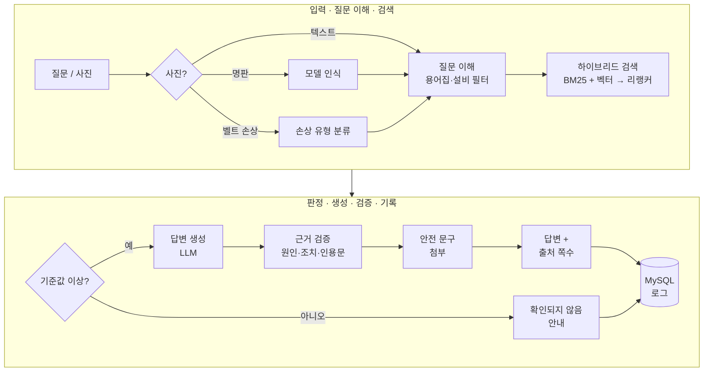

<div align="center">

# 🏭 Wanna Know — 현장 컨베이어 문제 해결 챗봇

<p>
  
</p>

**매뉴얼 PDF를 근거로, 컨베이어 장애 조치를 출처 쪽수와 함께 안내하는 RAG 챗봇**


[](https://github.com/WannaKnowHD/wanna_know)

</div>

> HYUNDAI AI Insight Campus · AI서비스 개발 1차 프로젝트 **5팀(6명)** 의 저장소를 fork 한 개인 저장소입니다.
> 기간 2026-10-21 ~ 11-02 · 주제 "기술 사양서 자동 해석 Q&A" (현대무벡스)
> **저(이정빈)는 DB·설정·답변 생성 프롬프트·근거 검증·KB 현황(PDF 추가)을 맡았습니다.** → [내가 맡은 부분](#내가-맡은-부분)

<!-- TODO: 시연 화면 캡처(로그인·채팅·관리자 대시보드)를 assets/ 에 넣고 여기에 연결 -->

## 목차

<div align="center">

[내가 맡은 부분](#내가-맡은-부분) -> [문제 해결 경험](#문제-해결-경험) -> [주요 기능](#주요-기능) -> [동작 구조](#동작-구조) -> [빠른 시작](#빠른-시작) -> [평가](#평가) -> [한계와 다음 과제](#한계와-다음-과제) -> [팀](#팀)

</div>

## 내가 맡은 부분

| 영역 | 파일 | 한 일 |
| --- | --- | --- |
| ⚙️&nbsp;**환경&nbsp;설정** | `chatbot/core/config.py` | 모든 설정을 `.env` 에서 읽는 `Settings.load()` 한 곳으로 모음. 빈 칸·범위 밖 값(예: 기준값 0~1)을 **한 번에 목록으로** 알려 주고 값을 구하는 위치까지 안내. 키·비밀번호 칸은 출력해도 보이지 않게(`repr=False`), 설정은 실행 중 바뀌지 않게(`frozen`) 함 |
| 🗂️&nbsp;**DB&nbsp;설계** | `chatbot/db/schema.sql` | ERD·테이블 6개(users·sessions·chat_logs·chat_history·kb_gaps·documents). 개인 데이터는 사원과 함께 삭제(CASCADE), 운영 통계는 남기고 사원번호만 비움(SET NULL). 전 테이블 기본키·`utf8mb4` |
| 🔌&nbsp;**DB&nbsp;연결** | `chatbot/db/db.py`<br>`scripts/test_db.py` | 최대 5개 연결 풀(동시 사용자), 꺼낼 때마다 `ping` 으로 끊긴 연결 복구, 연결마다 시간대 +09:00, SSL(CA 인증서) 적용. 접속 오류는 원인·해결법을 한 줄로 안내. 점검 스크립트로 접속·SSL·테이블·문자셋·관리자 계정 확인 |
| 👤&nbsp;**계정·시연&nbsp;데이터** | `scripts/seed.py` | 관리자·사원·데모 계정과 데모 로그 등록. **여러 번 실행해도 결과가 같게**(있으면 갱신, 같으면 건드리지 않음) 만들고, 옛 정의로 만든 테이블은 데이터를 유지한 채 바뀐 칸만 고침. 비밀번호는 PBKDF2-SHA256(60만 회)로 저장 |
| 💬&nbsp;**답변&nbsp;생성** | `chatbot/rag/prompts.py`<br>`chatbot/pipeline.py` | 규칙 11개짜리 시스템 프롬프트(자료에 있는 내용만, 원인 id 그대로, 인용은 원문 그대로, 안전 문구는 쓰지 않기). 검색 상위 5개를 tiktoken 으로 세어 **4,000토큰 안에서** 순위대로 넣고(`build_prompt`), 구조화 출력(JSON 스키마)·temperature 0 으로 생성(`generate`) |
| 🛡️&nbsp;**근거&nbsp;검증** | `chatbot/rag/validator.py` | LLM 답을 화면에 내보내기 전에 코드로 4가지 확인 — 형식, 한국어 여부, **원인 id 가 검색된 KB 에 실제로 있고 조치 개수가 같은지**, **인용문이 원문에 그대로 있는지**. 틀린 원인은 지우고 틀린 인용은 원문 문장으로 교체. 단위 테스트 32개 |
| 📚&nbsp;**KB&nbsp;현황·PDF&nbsp;추가** | `chatbot/ui/admin/kb_tab.py`<br>`chatbot/ui/admin/kb_files.py` | 관리자 화면에서 PDF 를 올리면 검사 → 저장 → 백그라운드 색인. 깨진·암호·스캔본·잘린 PDF, PDF 아닌 파일, 위험한 파일 이름, 같은 이름, 동시 추가를 막고, 색인이 실패해도 **기존 색인으로 계속 답변**. 예외 18가지 점검표 작성 |
| ☁️&nbsp;**DB&nbsp;서버&nbsp;운영** | Aiven MySQL | 팀 공용 DB 운영, SSL 접속·시연 전 서버 상태 확인 |

## 문제 해결 경험

**1. 백업용 로컬 DB 에서 한글이 깨짐**
로컬 MySQL·MariaDB 의 기본 문자셋이 `latin1` 이라, 같은 `schema.sql` 로도 실제로 latin1 테이블이 만들어지는 것을 확인했습니다. 모든 테이블에 `DEFAULT CHARSET=utf8mb4` 를 명시하고, `test_db.py` 가 테이블 문자셋까지 점검하도록 했습니다.

**2. 팀원 DB 에 남은 옛 테이블 정의로 계정 등록 실패**
`CREATE TABLE IF NOT EXISTS` 는 바뀐 정의를 반영하지 않아, 권한 값(`engineer` → `user`)과 해시 칸 길이가 옛 정의인 DB 에서 오류가 났습니다. `seed.py` 에 기존 계정을 유지하면서 바뀐 칸만 고치는 함수를 넣고, 새 DB·옛 DB 에서 각각 2회 실행해 2회차는 "그대로" 로 끝나는 것을 확인했습니다.

**3. 정답 KB 를 찾고도 "확인되지 않음" 으로 답함**
검증 기록(trace)을 따라가 보니, LLM 이 매뉴얼의 영어 원인 문장을 번역하지 않고 복사해 한국어 검사에서 탈락하고 있었습니다. 프롬프트 규칙을 "원인·조치는 반드시 한국어로, 영어 원문은 인용(quote)에만" 과 번역 예시로 보강해(`ANSWER_PROMPT_VERSION` v0 → v1), 예시 질문 10개가 모두 답변되도록 고쳤습니다.

**4. 예시 질문 하나만 계속 거절됨**
"벨트 가장자리가 닳았어요" 는 리랭커 점수 0.43 으로 기준값(0.55) 미만이었습니다. 질문 문구를 "…닳고 손상됐어요" 로 바꿔 0.65 로 통과시키고, 화면에는 짧은 문구를 그대로 두면서 내부로는 "컨베이어 …" 를 붙인 질문을 보내도록 바꿨습니다.

**5. PDF 추가 예외 점검에서 결함 발견**
예외 18가지를 실제 함수로 실행해 결과표를 만들다가, 스캔본·잘린 PDF 의 안내가 원인을 알려 주지 못하고 진행 안내에 Markdown 기호가 그대로 보이는 문제를 찾아 고쳤습니다.

## 주요 기능

| 기능 | 설명 |
| --- | --- |
| 📖&nbsp;**매뉴얼&nbsp;근거&nbsp;답변** | 증상을 말하면 원인·조치를 알려 주고, 답변마다 출처 문서와 쪽수를 붙입니다. |
| 🔎&nbsp;**하이브리드&nbsp;검색** | BM25와 벡터 검색을 합치고 리랭커로 다시 순위를 매겨 상위 5개를 근거로 씁니다. |
| 🛡️&nbsp;**근거&nbsp;검증** | LLM 답을 화면에 내보내기 전에 원인 ID·조치 개수·인용문이 검색된 자료와 맞는지 코드로 다시 확인합니다. |
| ⚠️&nbsp;**안전&nbsp;문구&nbsp;자동&nbsp;첨부** | 정비·조정 답변에는 `data/safety_rules.json`의 문구를 반드시 붙입니다. LLM이 만든 문구는 쓰지 않습니다. |
| 🙅&nbsp;**모르면&nbsp;모른다고&nbsp;답변** | 매뉴얼에 없는 질문은 지어내지 않고 "확인되지 않음"으로 처리합니다. |
| 📷&nbsp;**사진&nbsp;입력** | 설비 명판으로 모델을 인식하고, 벨트 손상 사진은 손상 유형을 분류해 KB와 연결합니다. |
| 🧑‍💼&nbsp;**로그인·대화&nbsp;기록** | 사원번호 로그인, 사용자별 설비 필터·대화 기록(MySQL)을 지원합니다. |
| 📊&nbsp;**관리자&nbsp;대시보드** | 운영 현황, 답변 품질 검토, KB 현황(문서 추가), 시스템 상태 4개 탭을 제공합니다. |

## 동작 구조



| 구분 | 사용 기술 |
| --- | --- |
| 화면 | Gradio 6 (로그인 · 채팅 · 관리자 대시보드) |
| 생성·사진 인식·임베딩 | OpenAI API |
| 검색 | rank-bm25, ChromaDB, sentence-transformers(bge-reranker-v2-m3) |
| 문서 처리 | PyMuPDF, tiktoken |
| 저장소 | MySQL (Aiven) — 계정·세션·대화·로그·KB 공백·문서 목록 |

## 빠른 시작

### 준비물

- Python **3.11**
- OpenAI API 키
- MySQL 접속 정보 (Aiven 을 쓰면 CA 인증서 `certs/ca.pem`)
- 매뉴얼 PDF 3개 (저작권 때문에 저장소에 없습니다)

> `.env`, `ca.pem`, 매뉴얼 PDF 는 직접 준비해야 하며 모두 커밋하지 않습니다.

### 1. 설치

```bash
git clone https://github.com/daui1727/wanna_know.git
cd wanna_know
python -m venv .venv
```

```bash
# macOS / Linux
source .venv/bin/activate
# Windows (PowerShell)
.venv\Scripts\Activate.ps1
```

```bash
pip install -r requirements.txt
```

### 2. 설정

```bash
cp .env.example .env      # Windows: copy .env.example .env
```

`.env`의 빈 값을 채우고 `certs/ca.pem`을 넣습니다.

```bash
python chatbot/core/config.py    # 설정이 모두 채워졌는지 확인 ([OK])
python scripts/test_db.py        # DB 접속 확인 (읽기만 함)
```

| 이름 | 용도 | 기본값·예시 |
| --- | --- | --- |
| `OPENAI_API_KEY` | OpenAI API 키 | 직접 발급 |
| `MODEL_TEXT` · `MODEL_VISION` | 답변 생성 · 사진 인식 모델 | 예: `gpt-4.1` |
| `EMBEDDING_MODEL` | 임베딩 모델 | `text-embedding-3-small` |
| `DB_HOST` · `DB_PORT` · `DB_USER` · `DB_PASSWORD` · `DB_NAME` | MySQL 접속 정보 | 직접 준비 |
| `DB_SSL_CA` | CA 인증서 경로 (비우면 SSL 없이 접속) | `certs/ca.pem` |
| `BROWSER_STORAGE_KEY` · `BROWSER_SECRET` | 로그인 세션 저장 키 · 암호화 값 (**고정값**이어야 재시작 후에도 로그인 유지) | `cv_session` · 직접 정함 |
| `SESSION_HOURS` | 로그인 유지 시간 | `8` |
| `NOT_FOUND_THRESHOLD` | 이 점수 미만이면 "확인되지 않음" 처리 | `0.55` |
| `IMAGE_CONFIDENCE_THRESHOLD` | 사진 인식 확신도 기준 | `0.6` |
| `SEED_ADMIN_PASSWORD` · `SEED_USER_PASSWORD` | `seed.py`가 만들 계정 비밀번호 (8자 이상) | 직접 정함 |

### 3. DB 준비

테이블을 만들고 계정과 데모 로그를 넣습니다. 여러 번 실행해도 안전합니다.

```bash
python scripts/seed.py              # 테이블 + 계정 + 데모 로그
python scripts/seed.py --no-demo    # 테이블 + 계정만
```

| 사원번호 | 역할 | 비밀번호 |
| --- | --- | --- |
| `A0001` | 관리자 | `.env`의 `SEED_ADMIN_PASSWORD` |
| `E0001` | 일반 사원 | `.env`의 `SEED_USER_PASSWORD` |
| `D0001` | 데모 사원 (데모 로그 전용) | `.env`의 `SEED_USER_PASSWORD` |

### 4. 색인 만들기

매뉴얼 PDF 3개를 `data/raw/initial/`에 넣습니다.

| 문서 | 파일 이름 |
| --- | --- |
| Hytrol 138 시리즈 | `hytrol_138acc_p1-27.pdf` |
| Fenner Dunlop 벨트 | `Fenner-Dunlop-Conveyor-Belt-Manual-21-39.pdf` |
| PRECO L 시리즈 | `preco_l_series_p6-29_54-60.pdf` |

```bash
python build_index.py    # KB·색인 전체 재생성 (OpenAI 임베딩 호출)
```

> `kb/`의 KB JSON은 저장소에 이미 들어 있습니다. 매뉴얼의 표 내용을 바꿨을 때만 `python scripts/build_kb.py`로 다시 만듭니다.

### 5. 실행

```bash
python app.py
```

브라우저에서 터미널에 표시된 주소(기본 http://127.0.0.1:7860)를 엽니다. 처음에는 리랭커 모델을 불러오느라 시작이 조금 걸립니다.

### 명령 모음

| 명령 | 하는 일 |
| --- | --- |
| `python app.py` | 챗봇 실행 |
| `python build_index.py` | KB·색인 전체 재생성 |
| `python scripts/build_kb.py` | 매뉴얼 표 → `kb/*.json` 재생성 |
| `python scripts/seed.py` | 테이블·계정·데모 로그 등록 |
| `python scripts/test_db.py` | DB 접속·테이블·계정 점검 |
| `python eval/run_eval.py` | 평가셋 자동 채점 |
| `pytest` | 단위 테스트 + 기능명세서 일치 확인 |

## 평가

평가셋 100문항(텍스트 + 사진, 튜닝에 쓰지 않음)과 개발셋 17문항으로 버전마다 한 가지씩만 바꿔 비교했습니다.

```bash
python eval/run_eval.py                         # 평가셋 전체
python eval/run_eval.py --set dev               # 개발셋
python eval/run_eval.py --version v2 --no-log   # 결과 파일 이름 지정, DB 로그 안 남김
```

결과는 `eval/results/{버전}_{날짜시각}.csv`(지표 요약)와 `..._cases.csv`(문항별)로 저장됩니다.

### 버전별 결과 (v0 ~ v3, 평가셋 100문항, 2026-10-30)

목표값은 `v0 + (1 − v0) × 0.5`(개선 비율 50%)로 정했습니다. 안전·정밀도는 고정값, 과잉 거절률·응답 시간은 넘으면 안 되는 상한입니다.

| 구분 | 지표 | 방향 | v0 | v1 | v2 | v3 |
| --- | --- | :---: | ---: | ---: | ---: | ---: |
| 검색 | Top-1 KB 정확도 | ↑ | 67.6% | 64.8% | 85.7% | 85.7% |
| 검색 | Recall@5 | ↑ | 87.8% | 87.8% | 93.9% | 93.9% |
| 답변 | 원인 재현율 | ↑ | 83.7% | 81.4% | 86.0% | 86.0% |
| 답변 | 원인 정밀도 | ↑ | 96.4% | 94.6% | 94.8% | 94.8% |
| 출처 | 출처 정확도 (문서·원본 쪽) | ↑ | 76.1% | 76.1% | 79.2% | 79.2% |
| 신뢰성 | 모름 처리율 | ↑ | 100% | 100% | 100% | 100% |
| 신뢰성 | 과잉 거절률 | ↓ | 19.7% | 16.9% | 14.5% | 14.5% |
| 안전 | 안전 문구 포함률 | ↑ | 100% | 100% | 100% | 100% |
| 멀티모달 | 그림 질문 정답률 (10문항) | ↑ | 30.0% | 20.0% | 80.0% | 80.0% |
| 사진 | 사진 입력 정답률 (10문항) | ↑ | 40.0% | 50.0% | 50.0% | 90.0% |
| 사진 | 명판 인식 정확도 (합성 명판 20장) | ↑ | - | 90.0% | 90.0% | 90.0% |
| 속도 | 응답 시간 p95 · 텍스트 | ↓ | 43.6초 | 36.0초 | 23.6초 | 23.6초 |
| 속도 | 응답 시간 p95 · 사진 | ↓ | 41.1초 | 34.2초 | 31.0초 | 31.0초 |

**v3 기준 13개 지표 중 7개 달성.** 남은 과제는 Recall@5·원인 재현율·출처 정확도·과잉 거절률·사진 응답 시간입니다.

| 버전 | 바꾼 것 (한 번에 하나) | 고친 오답 유형 |
| --- | --- | --- |
| v0 | 기준 버전: 하이브리드 검색 + 리랭커 + 근거 검증 + 모름 처리 + 설비 필터 + 용어집 + 사진 (gpt-4.1) | - |
| v1 | 속도·답변 형식 안정화: 리랭커 미리 불러오기, 입력 256토큰, **번역 규칙·한국어 재요청**, 예시 질문에 "컨베이어" 추가 | 느린 응답, 영어 원인이 한국어 검사에서 탈락, 질문 대상 불분명 |
| v2 | 모름 처리 기준값 `NOT_FOUND_THRESHOLD` 0.55 → 0.45 (개발셋으로만 조정) | 답이 있는데 "확인되지 않음"으로 답한 과잉 거절 |
| v3 | 손상 사진 처리: 후보 KB 연결, 검색 질의 보강, 손상 사진 프롬프트 안내 | 손상 사진에 "확인되지 않음" |

## 한계와 다음 과제

- **응답 시간**: 중앙값 약 23초 중 검색이 약 80%로, 대부분 CPU 에서 도는 리랭커 시간입니다. GPU 사용·리랭킹 후보 축소·자주 묻는 질문 캐시로 줄일 수 있습니다.
- **스캔본 PDF**: 본문을 PDF 안의 글자로 추출하고 인용문을 원문과 글자 그대로 대조하는 구조라, OCR 오류가 근거를 틀리게 만들 수 있는 스캔본은 업로드 단계에서 막습니다.
- **한글 매뉴얼**: 본문 검색·답변은 되지만, 고장 표 → KB 자동 변환과 인용 보정이 영어 매뉴얼 기준이라 원인·조치 카드 품질이 떨어질 수 있습니다.
- **DB 마이그레이션**: 테이블 정의 변경은 `seed.py` 의 보정 함수로 처리했고, 정식 마이그레이션 도구(Alembic 등)는 쓰지 않았습니다.

## 폴더 구조

```
app.py · build_index.py        실행 파일
chatbot/
├─ pipeline.py                 질문 처리 파이프라인 (검색 → 생성 → 검증)
├─ ui/                         화면 (로그인 / 채팅 / 관리자 대시보드)
├─ rag/                        문서 처리·색인·검색·생성·검증·용어집
├─ vision/                     사진 처리 (명판·벨트 손상)
├─ core/                       설정, 로그인·세션, 대화 상태, 안전 문구, 로그, 공통 데이터 클래스
└─ db/                         MySQL 연결, 테이블 정의(schema.sql)
data/                          원본 PDF(커밋 안 함), 용어집·모델 목록·안전 규칙 등
kb/                            매뉴얼 표에서 만든 KB JSON
eval/                          평가 스크립트·평가셋·결과
scripts/                       seed.py · test_db.py · build_kb.py
tests/                         단위 테스트·명세서 일치 테스트
```

## 팀

<table>
  <tr>
    <td align="center"><a href="https://github.com/seram2002-wq"><br><b>박세람</b></a><br>팀장</td>
    <td align="center"><a href="https://github.com/Rose-Rosie-Rose"><br><b>강경원</b></a><br>Repo Owner</td>
    <td align="center"><a href="https://github.com/wintery7"><br><b>김민재</b></a><br>팀원</td>
    <td align="center"><a href="https://github.com/clipnpaper"><br><b>김현준</b></a><br>팀원</td>
    <td align="center"><a href="https://github.com/daui1727"><br><b>⭐ 이정빈</b></a><br>DB · 생성 · 검증</td>
    <td align="center"><a href="https://github.com/Y1OO5B"><br><b>조윤빈</b></a><br>팀원</td>
  </tr>
</table>

팀 작업 방식: `feat/*` · `fix/*` · `docs/*` 브랜치에서 작업해 `dev` 로 PR, 리뷰 후 병합. 관리자 함수는 화면에서 숨겨도 API 로 호출될 수 있으므로 함수 안에서 권한을 다시 확인하는 규칙을 지켰습니다.

## 참고

- 매뉴얼 PDF(Hytrol, Fenner Dunlop, PRECO)의 저작권은 각 제조사에 있으며 저장소에 포함하지 않습니다.
- 시연용 모듈러 벨트 문서(`mb200`)는 관리자 화면의 "KB 현황"에서 PDF를 추가하는 시연에 씁니다.
